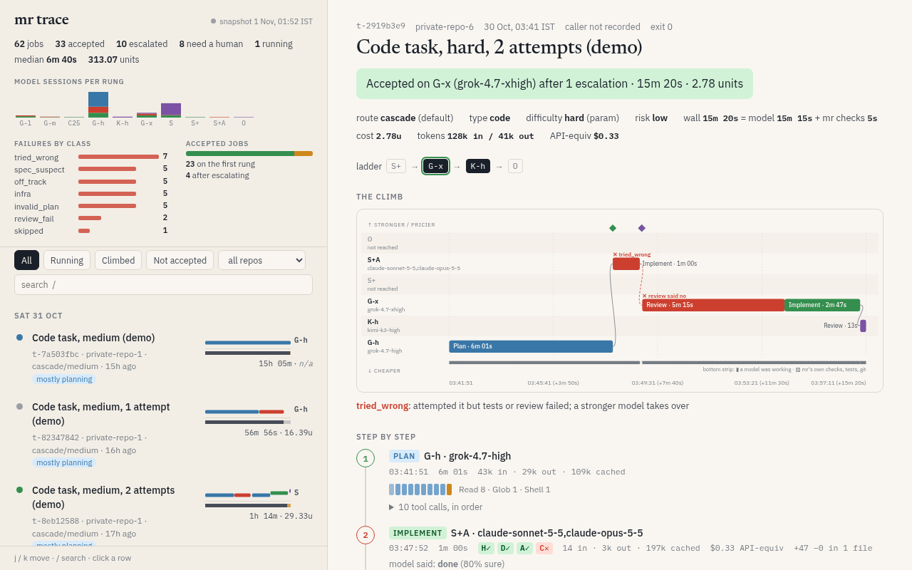
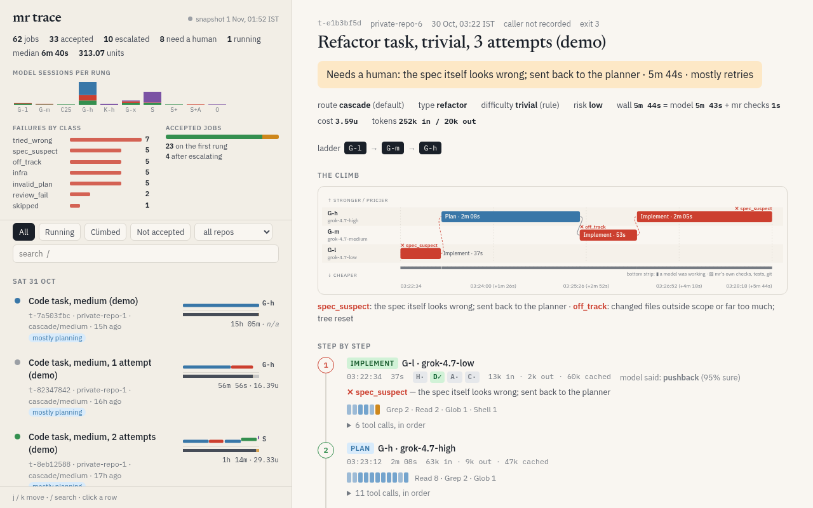

# mr — a model router for coding tasks

`mr` sends a coding task to the cheapest AI coding model that can probably do it, checks the result with your
tests and a reviewer model, and climbs to a stronger (pricier) model only when the cheaper one fails. You get a
verified change in your repo, or a clear report of why it stopped.

## The problem

Strong models are expensive and rate-limited; cheap models are fast but get things wrong. Picking by hand for every
task wastes either money or time. `mr` makes the choice per task:

1. **Route.** A rules-based prepass reads the task (type, difficulty, risk, files named) and picks a *ladder* of
   rungs, cheapest first (for example `G-h → G-x → S`).
2. **Plan.** A planner model writes a short checklist of requirements and locks acceptance tests for them.
3. **Run.** The first rung implements the change in your repo.
4. **Verify.** mr runs your repo's checks (hygiene commands), the locked acceptance tests and a cross-family
   reviewer (a model from a different family than the one that wrote the code).
5. **Escalate or stop.** On failure mr classifies why (skipped, tried wrong, spec suspect, off track, infra) and
   either retries with more effort, moves up the ladder, or stops and asks a human. Hard caps limit attempts and
   expensive rungs per task.

Every step is logged to a local JSONL file, and `mr trace` shows each task as a climb up the price ladder (see
[See every run](#see-every-run-mr-trace)).

## Prerequisites

- Python **3.13** or newer, and `git`.
- At least one coding-agent CLI, installed and signed in with your own account:
  - [Cursor CLI](https://cursor.com/cli) (`cursor-agent`): runs the Grok, Composer and Kimi rungs.
  - [Claude Code](https://docs.anthropic.com/en/docs/claude-code) (`claude`): runs the Sonnet and Opus rungs.

  With both, mr uses cheap Cursor rungs first and Claude rungs for escalation and review. With only one, `mr setup`
  rewrites every ladder to use that provider only. mr never stores keys or tokens; each CLI keeps its own sign-in.

## Install

```bash
git clone https://github.com/Ronitron007/mr.git && cd mr
python3.13 -m venv .venv && . .venv/bin/activate
pip install .            # or: pip install -e .  for development
mr --help
```

The only runtime dependency is PyYAML.

## Quickstart

```bash
mr setup                              # detect cursor-agent / claude on PATH and write your config
mr setup --check                      # re-validate any time; changes nothing
cd path/to/your/git/repo              # a clean working tree
mr route --explain "add a function that parses ISO dates in src/dates.py"   # dry run: no model is called
mr run "add a function that parses ISO dates in src/dates.py"
mr log --tail 20                      # what happened, from the local log
mr trace serve                        # open the printed local address to see the run
```

`mr setup` options: `--provider cursor|claude` (repeatable), `--cursor-agent PATH`, `--claude PATH`, `--yes`
(no prompts), `--print` (show the YAML, write nothing), `--force` (overwrite an existing config).

Useful `mr run` flags: `--type` (code, bugfix, refactor, test, ui, docs, ...), `--difficulty` (trivial ... critical),
`--route cascade`, `--budget free|low|normal|high`, `--dry-run`, `--repo PATH`, `--yes` (skip the confirmation),
`-f FILE` (read the task from a file).

## See every run: `mr trace`

mr writes every route, plan, attempt, review and guard decision to its local log. `mr trace` turns that log into
pictures, so you can see at a glance which models a task climbed through, where it failed and why, where the time
went, and how it ended, without reading JSONL.



**The climb (ladder chart).** A task is a climb up a price ladder until something passes the checks, so each task
is drawn as one chart: time runs left to right, and rungs run from cheap at the bottom to strong and expensive at
the top. Each bar is one step (plan, implement, review) on the rung that ran it; red bars failed, and the failure
class is written next to them (`tried_wrong`, `spec_suspect`, `off_track`, ...) with a plain-English line under the
chart. A strip along the bottom splits the wall time into "a model was working" and "mr's own checks, tests, git".

**The task page** opens with the outcome headline (accepted on which rung after how many escalations, needs a
human and why, exhausted, interrupted), then the route, type, difficulty, risk, wall time, cost and tokens, and the
ladder with the rung that won highlighted. Below the chart, **step by step** cards show each step's model, time,
tokens, cost, diff size, the H/D/A/C check signals, what the model said it did (done, pushback, blocked), and its
tool calls in order (for cursor rungs, read from the cursor-agent transcripts under `~/.cursor/projects`, or
`MRTRACE_CURSOR_PROJECTS`).

**The all-jobs board** on the left has a summary strip (jobs, accepted, escalated, needing a human, running,
median time, total cost units), model sessions per rung, failures by class and how many jobs were accepted on the
first rung versus after escalating. Below it every job is listed with its own mini climb. Filter by Running,
Climbed or Not accepted and by repo, search with `/`, and move with `j`/`k`. A job's id in the URL
(`#t-2919b3e9`) opens it directly.



### Trace commands

| Command | What you get |
|---|---|
| `mr trace serve [--port 8765] [--host 127.0.0.1]` | A live local page at `http://127.0.0.1:8765/`. It re-reads mr's records while you watch (the page polls every 4 s) and shows the step that is running right now. Ctrl-C stops it. |
| `mr trace build [-o mr-trace.local.html]` | One self-contained HTML file with your real data, to open offline. `*.local.html` is git-ignored; it contains your task titles, so keep it private. |
| `mr trace show TASK_ID` | The story of one task in the terminal (add the global `--json` for the raw trace). |
| `mr trace demo [-o docs/index.html] [--data docs/demo-traces.json]` | A scrubbed snapshot that is safe to publish, plus the scrubbed data as JSON. |

All of them read mr's data dir (`MR_HOME`, else `paths.home` from your config, else the default data dir); pass
`mr trace --home PATH <command>` to point at another one. The viewer only reads; it never changes mr's records.

```text
$ mr trace show t-2919b3e9
t-2919b3e9  Code task, hard, 2 attempts (demo)
Accepted on G-x (grok-4.7-xhigh) after 1 escalation · 15m 20s · 2.78 units
  1. Plan on G-h (grok-4.7-high) · 6m 01s · ok
  2. Implement on S+A (claude-sonnet-5-5,claude-opus-5-5) · 1m 00s · failed: tried_wrong · +47 -0 in 1 file
  3. Review on G-x (grok-4.7-xhigh) · 5m 15s · failed
  4. Implement on G-x (grok-4.7-xhigh) · 2m 47s · ok · escalated from S+A · +42 -0 in 1 file
  5. Review on K-h (kimi-k3-high) · 13s · ok
```

### What `mr trace demo` scrubs

Real task text never goes into a demo. `demo`:
- replaces every title with a synthetic one built only from routing facts (for example "Code task, medium,
  2 attempts (demo)") and drops the "why it stopped" text;
- renames repos to `private-repo-1`, `private-repo-2`, ... (only `scratch-repo`, plus any names you list in
  `MR_TRACE_PUBLIC_REPOS`, keep their names) and renames non-task labels to `review-N`;
- drops prompts, model summaries, pushback text, requirements, patch and raw-output paths, session ids, commits,
  working dirs and the caller, and keeps only the name and kind of each tool call (no arguments);
- turns any remaining string that looks like a path into `[path]` and anything that looks like a key or token
  into `[redacted]`;
- refuses to write anything (exit 1) if a real title or label of 12 or more characters, or a secret-looking string,
  still survives.

The screenshots above come from scrubbed demo data.

## Commands

| Command | What it does |
|---|---|
| `mr setup` | Detect provider CLIs and write a user config (`--check` validates only). |
| `mr route TASK [--explain]` | Show the route mr would take: type, difficulty, risk, ladder. No model calls with `--no-models`. |
| `mr run TASK` | Plan, implement, verify and escalate until accepted or stopped. |
| `mr review` | Cross-family review of a diff. |
| `mr log` | Pretty-print the run log (`--task`, `--role`, `--tail`). |
| `mr trace serve / build / show / demo` | Local viewer for runs: live page, one-file HTML snapshot, a terminal story of one task, or a scrubbed demo. |
| `mr gc` | Clean up mr's own branches and worktrees (`--dry-run` first). |
| `mr unlock --repo PATH` | Clear a writer lock left by a crashed run. |
| `mr guard` | Show the Claude usage gate decision (only meaningful with a usage check script). |
| `mr droid check / reset` | Check the optional droid (BYOK) backend, or clear its fallback state. |

Exit codes: `0` accepted, `1` not accepted, `2` usage or config error, `3` needs a human, `4` refused for git
safety, `10` Claude gate denied, `75` deferred, `70` internal error.

## Where files live

| What | Default | Override |
|---|---|---|
| Config | `$XDG_CONFIG_HOME/mr/routes.yaml` (else `~/.config/mr/routes.yaml`) | `--config PATH` or `MR_CONFIG` |
| Data: run log, raw model output, task state, saved patches | `$XDG_DATA_HOME/mr` (else `~/.local/share/mr`) | `MR_HOME`, or `paths.home` in the config |

Without a config file mr uses its built-in defaults. A user config is deep-merged over them, so it only needs the
keys you change.

## Configuration reference

The config is YAML (`version: 1`). Main keys:

- `paths`: `claude` and `cursor_agent` (absolute path or a command on PATH), `check` (optional absolute path to a
  Claude usage-check script; empty means no usage gate), `home` (data dir; empty means the default above).
- `rungs`: rung code → `{model, path: cursor|max, effort}`. `cursor` rungs run through `cursor-agent`, `max` rungs
  through the `claude` CLI. Anthropic models only ever run through the `claude` CLI.
- `allowed`: model patterns rungs may use. Validation rejects anything else.
- `ladders`: per task type and difficulty, the list of rungs to climb (or `design_route`).
- `hygiene.commands`: per repo (directory name), the commands that must pass after every attempt, for example
  `my-app: ["npm test"]`.
- `acceptance.runners`: per repo, how locked acceptance tests run (`unittest`, `pytest`, `vitest`).
- `review`, `planner`: which rung reviews or plans, by author family and difficulty.
- `caps`, `timeouts`: attempts per difficulty, Claude and Opus rungs per task, per-step timeouts in seconds.
- `advisor`, `judge`, `classifier`: optional extras (the judge and classifier are off in v0.1).

Example: run the repo's tests after every attempt and give slow models more time.

```yaml
version: 1
hygiene:
  commands:
    my-app: ["python -m pytest -q"]
acceptance:
  runners: {my-app: pytest}
timeouts: {rung_s: {cursor: 1800, claude: 900}}
```

### Droid backend (BYOK)

The Sonnet rungs `S` and `S+` can run on the [Factory](https://factory.ai) `droid` CLI with your own Anthropic API
key instead of the `claude` CLI. It is off by default and Sonnet only (no Opus, no planner, reviewer or advisor).

1. Install `droid`, put your key in the environment variable named in `droid.provider_key_env` (default
   `ANTHROPIC_API_KEY`), and set `droid.enabled: true` in your config. mr writes a settings file under its data dir
   (`droid/settings.json`); it holds only a `${ANTHROPIC_API_KEY}` reference, never the key, and mr refuses a
   settings file with a literal key.
2. When droid is usable, `S` and `S+` try it first. These calls bill your API key, so they skip the Claude usage
   gate. The key is passed to droid children only; `claude` and `cursor-agent` children never see it.
3. If droid reports an empty credit balance or a bad key, mr restores the tree, runs the same attempt on the
   `claude` CLI (the droid try does not count as an attempt), and sticks to the `claude` CLI for
   `droid.recheck_s` seconds (default 3 hours) before trying droid again. A rate-limit or overload error falls back
   for that attempt only. An ordinary task failure counts like any other failed rung.
4. `mr droid check --probe` makes one tiny call and reports the result (exit `0` ok, `2` no binary, `3` no key,
   `4` bad key, `5` no credits, `1` other error); `mr droid reset` clears the sticky state.

## Safety notes

- mr works in the repo you point it at. Started on a protected branch (`main`, `master`, `release/*`,
  `production`), it creates its own `mr/<date>-<slug>` branch and commits an accepted change there. Started on your
  own feature branch, it edits in place and leaves the accepted change uncommitted for you to review.
- It refuses (exit 4) a working tree with uncommitted changes it does not own, and a repo where another writer
  holds the lock.
- Tasks that look high risk (auth, payments, data deletion, schema changes, dependency or native config changes)
  need an isolated worktree, which v0.1 does not build yet, so mr refuses them (exit 4). Do those by hand.
- Model children run with git push disabled (push URLs point nowhere); mr itself never pushes.
- Coding agents run with permission to edit files and run commands in your repo. Use mr on code you can review
  and revert, and review every change before you merge it.
- Your task text and model output stay in your local data dir. `mr trace demo` scrubs titles, paths and anything
  that looks like a secret before writing a shareable page, and refuses to write if something survives.
- Model calls cost money or plan quota on your own accounts. Use `mr route --explain` to see the ladder first, and
  `--budget` to cap it.

## Optional: hosted trace viewer

`mr/trace/deploy/` has a small Cloudflare Worker (`worker.js`, `wrangler.example.toml`) and `publish_r2.sh` to
upload a real-data snapshot to your own private R2 bucket behind a secret link. It is opt-in, uses your own
account, and reads its upload URL and token from an env file outside the repo (`MR_TRACE_ENV`).

## Development

```bash
pip install -e .
python -m unittest discover -s tests -t .     # or: tests/run_all.sh
```

Tests use fake `cursor-agent` and `claude` scripts and temp dirs only: no network, no real CLIs, no real home.

## License

MIT. See [LICENSE](LICENSE).
